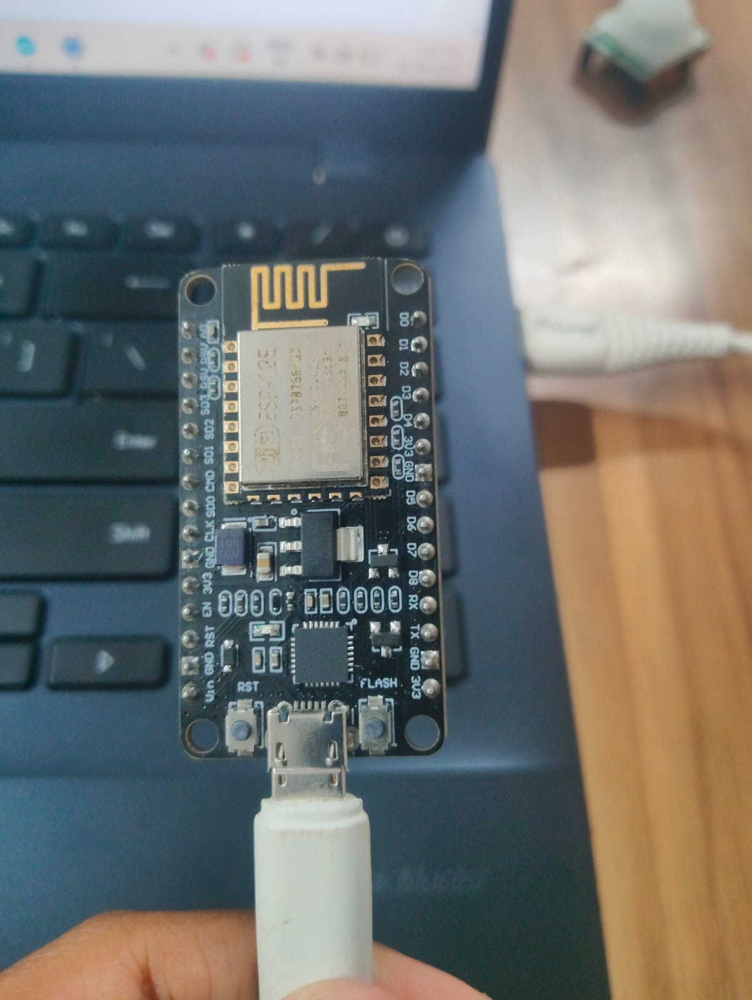
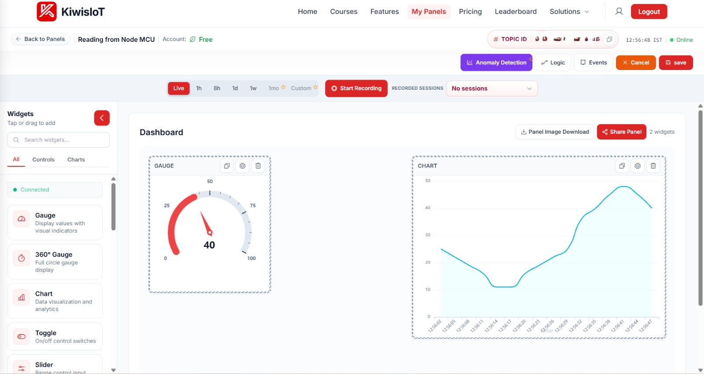

# Node-MCU-using-IoT
# KiwisIoT ESP8266 IoT Connection
# Description
An IoT project using NodeMCU ESP8266 to send numerical values to a KiwisIoT widget through Wi-Fi in forward and backward sequences.
# Components Required
- NodeMCU ESP8266
- Wi-Fi connection
# output

# Source Code
[View Source Code](nodemcu.ino)
# Technologies Used
- Arduino IDE
- ESP8266
- KiwisIoT
# Working
- Stores predefined values using an array.
- Sends values in forward and backward order.
- Updates the KiwisIoT widget every 3 seconds.
